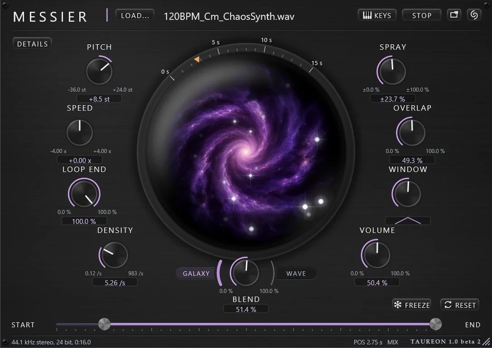
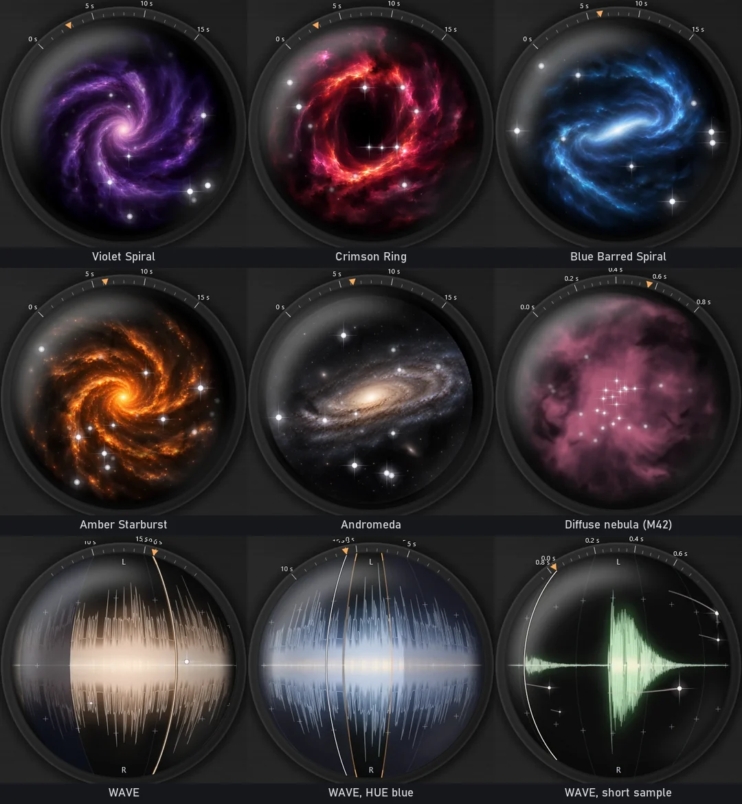
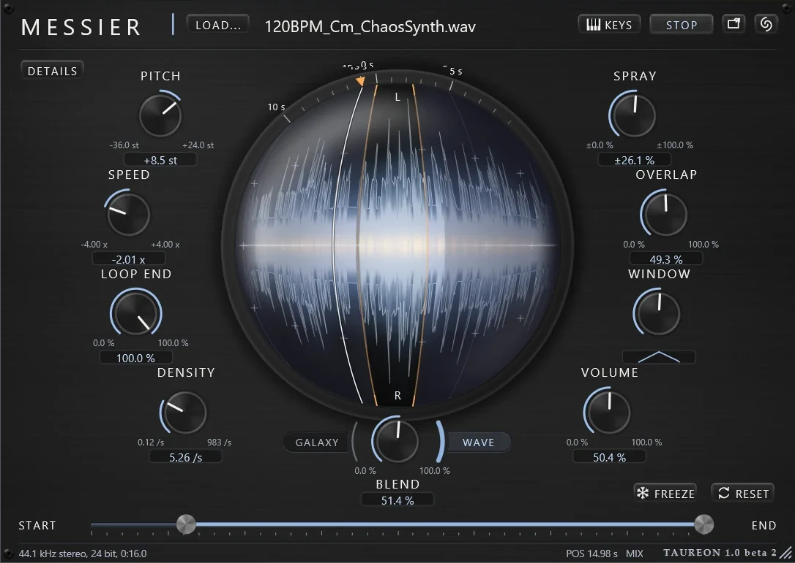

# Messier 1.0 beta 2

Messier is a VST3 instrument for Windows x64. It plays a WAV file as a loop through a
phase vocoder and a granular processor, with pitch and speed independent of each other.
Its sound engine is the hardware-free core of the Daisy Seed firmware *Nebulae on Daisy*
0.2.2, itself an adaptation of the default Granular Looper of Qu-Bit Electronix' Nebulae
v2.1.2. Nothing here is made, endorsed or supported by Qu-Bit Electronix.

This is a **beta**: free and non-profit, for testers. It comes **without warranty**, as
its licenses say.

## What is new

Beta 2 brings a new window. The sound engine, the parameters, MIDI and automation are
those of beta 1: the engine still matches the separately compiled firmware sample for
sample.

* **A round glass** in the middle, the knobs on two arcs beside it and BLEND below it. The
  window scales from 50 to 200 %.
* **GALAXY** shows a slowly turning galaxy or nebula. It turns with the playback's tempo
  and direction and rests at STOP and Freeze. Dark clouds turn against it; BLEND
  thickens them. Each grain is a star that flies out from the centre while it sounds
  (inwards when the playback runs backward).
* **Nine looks** in the preset menu:
  * five painted galaxies in full colour: Violet Spiral, Blue Barred Spiral, Crimson
    Ring, Amber Starburst and Andromeda;
  * four more restrained white nebulae: a spiral galaxy, a barred spiral, a ring nebula
    and a diffuse nebula.
* **WAVE** lays the waveform onto the glass like a globe, with a soft halo, a bright core
  and a crisp outline.
  * The waveform turns round the glass with the playback, at its tempo and in its
    direction, and glides under the playhead. What runs out at one rim comes in at the
    other.
  * Where grains can start (the spray range round the playhead) the glass is clear; the
    rest of the loop is lightly shaded, the rest of the file darker.
  * Quiet files are shown as tall as loud ones (at most 8 times).
* **HUE** turns the colour of the galaxy and the accents all round the colour circle. At
  either end of the slider the preset keeps its own colours.
* **START and LOOP END:** the START slider carries a second thumb for the loop's end.
  Parameter 102 is now called Loop End; its ID and values are unchanged.
* **A one-octave keyboard** of touch pads, with LATCH and octave keys.

The galaxy pictures are original illustrations made with AI image tools. They are not
NASA or ESA photographs and do not show real observations.

## Install

1. Download `Messier-1.0.0-beta.2-win-x64.zip` and unpack it.
2. Copy the folder `Messier.vst3` into `C:\Program Files\Common Files\VST3\`, replacing
   beta 1's.
3. Let the host rescan its plug-ins.

No Visual C++ runtime is needed. The host lists the version as 1.0.0; the window shows
"1.0 beta 2".

Projects of beta 1 open with their sound unchanged. A window state of beta 1 opens with
the white nebula that takes its preset's place.

## Known limitations

* Windows x64 only. So far tested in Studio One only.
* The window's animation runs on the GUI thread. Laying the turning waveform onto the
  glass takes about 1.4 ms a frame at 100 %; the turning galaxy is of the same order. On
  a slow machine with the window open, close it or switch to a still view if the host's
  interface stutters.
* In WAVE the waveform's soft layers are made at one pixel per window unit, so they look
  a little softer at 200 % than its outline.
* High load at 192 kHz with very small host buffers: single blocks of 64 samples can take
  longer than the block. If you hear dropouts at 192 kHz, raise the buffer size.
* After a restart (activation, loading a project) the secondary controls glide up from 0
  over about 60 ms, as on the original module.
* Only the file source: live input, recording and the input controls are not there yet;
  the sidechain input exists but is not read.
* A project stores the WAV file's path, not the audio. A moved or missing file leaves the
  project silent, with its path kept.
* Files are kept as 16-bit PCM (24-bit and float files are rounded, without dither), up
  to 256 MiB, about 23 minutes of stereo at 48 kHz. Files above 48 kHz are read without a
  low-pass, so content above 24 kHz folds back.
* One pitch wheel for all MIDI channels.
* In custom skin tables, `negative`, `wave`, `wave_outside` and `loop_edge` have no
  effect yet.

## Bug chasing welcome

Please hunt for bugs and report them as GitHub issues, with the bug report form:
<https://github.com/sscheidl/vst3_Plugins/issues/new?template=bug_report.yml>

Earlier reports, to see whether yours is known: <https://github.com/sscheidl/vst3_Plugins/issues>

A good report contains:

* the host and its version;
* the sample rate and buffer size;
* the WAV file's format: bits, rate, mono or stereo, length;
* the steps that lead to the problem, and what you expected instead;
* the project file, if you can share it.

## Made with AI

AI coding was essential to Messier. The plug-in was written largely with Claude Code
(Anthropic). The new window was built in ten test rounds with the author in Studio One.
Its code was reviewed by an independent Claude session and by ChatGPT (OpenAI); the
galaxy pictures came from ChatGPT. The author directed the work and tested it.
Every review and its fixes are documented in the repository (`instruments/messier/docs/`):

* the review brief: `GUI_PRUEFAUFTRAG_1.0.0-beta.2.md`;
* the reviews: `CLAUDE_REVIEW_1.0.0-beta.2_GUI.md` and `GPT_REVIEW_1.0.0-beta.2_GUI.md`;
* the verdicts and fixes: `GUI_REVIEW_1.0.0-beta.2_VERDICTS.md` and
  `GUI_REVIEW_1.0.0-beta.2_UMSETZUNG.md`;
* the test rounds and the build: `BUILD_REPORT_1.0.0-beta.2.md` and the CHANGELOG.

## Licenses

Messier is under the MIT license, except its phase vocoder (`core/reference_dsp.h` and
`core/reference_dsp.cpp`), which is adapted from Csound (`Opcodes/pvlock.c`, windows as
in `Engine/fgens.c`) and is under the GNU Lesser General Public License 2.1 or later. The
license texts are in the `licenses` folder that comes with the bundle.

The release folder's `BUILD_INFO.txt` names the commit of
<https://github.com/sscheidl/vst3_Plugins> the bundle was built from. With it, the
phase vocoder can be changed or replaced and the bundle rebuilt; the plug-in's README
gives the steps.

VST is a registered trademark of Steinberg Media Technologies GmbH.
