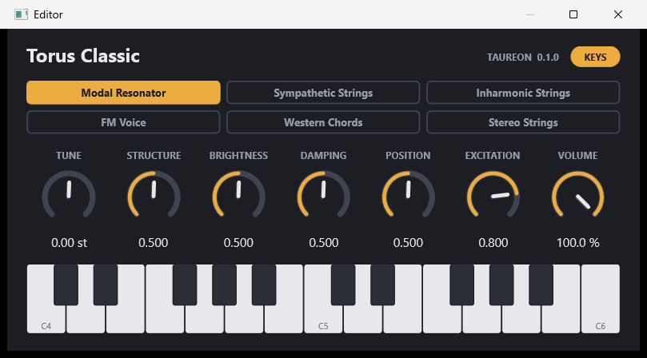

# Kekulé

VST3 instrument, version 0.3.1, Windows x64. The Rings/Torus keyboard engine
of the Daisy Seed3 firmware *Physical Modeling*, without its reverb, inside a
native plug-in: six synthesis models, 4, 8 or 16 voices, dry stereo output,
with a low-pass and a limiter at the end.



**Name:** Kekulé, after August Kekulé, who found the benzene ring: Rings,
ring, Kekulé. Hosts show it with the accent; the bundle is `Kekule.vst3`,
without it, because some hosts and tools mishandle accents in file names.
Up to 0.2.1 the plug-in was called Torus Classic, and that stays the internal
name of the project: this directory, the branch, the build targets, the
namespaces and the test names. The class IDs, the parameters and the saved
state are those of Torus Classic, so projects and presets saved with it load
in Kekulé.

**Status:** built and tested automatically on one machine; passes Steinberg's
validator.

* First DAW result, version 0.1.0 in Studio One on 2026-11-14: it loads and
  is displayed correctly; screen keys, knobs, MIDI notes and the pitch wheel
  work; saved settings come back; the CPU load is negligible. Waveform, Live
  and the rest of the [DAW test list](docs/DAW_TEST_0.1.0.md) are open.
* Codex reviewed 0.1.0 and found four defects
  ([review](docs/CODEX_REVIEW_0.1.0.md)). They are fixed since 0.1.1
  ([what was done](docs/CODEX_REVIEW_0.1.0_UMSETZUNG.md)); the fixes have not
  been re-reviewed.
* 0.2.0 adds what the first DAW test asked for: Damping the other way round,
  Tune in semitones with a switch for free tuning, a low-pass, a limiter, and
  MIDI notes from the screen keys. None of that has been in a DAW yet. See
  the [change log](CHANGELOG.md).
* Codex re-reviewed 0.2.0: the four defects of 0.1.0 are fixed; it found five
  new ones ([review](docs/CODEX_REVIEW_0.2.0.md)). 0.2.1 fixes them
  ([what was done](docs/CODEX_REVIEW_0.2.0_UMSETZUNG.md)).
* Codex re-reviewed 0.2.1 and released it for the DAW test
  ([review](docs/CODEX_REVIEW_0.2.1.md)): the five defects are fixed, nothing
  new of priority P0 to P2. One minor point (TC-R10, P3) concerned a test and
  an internal helper, not the plug-in's own path; 0.3.0 fixes it.
* 0.2.2 only renames the plug-in to Kekulé.
* 0.3.0 added a choice of 4, 8 or 16 voices, a report of rest for Studio
  One's Plug-in Nap, a lock instead of the FREE switch and knob rings in
  three colours. Codex reviewed it and did not release it
  ([review](docs/CODEX_REVIEW_0.3.0.md)): three findings concerned the rest
  report, one the order of voices after a change of their number.
* 0.3.1 drops the rest report: Plug-in Nap is not supported (see
  [No Plug-in Nap](#no-plug-in-nap)), which settles those three findings;
  the fourth is documented ([what was done](docs/CODEX_REVIEW_0.3.0_UMSETZUNG.md)).
  It adds octave keys to the screen keyboard and takes the knob colours from
  Mendelejew. Not in a DAW yet, not re-reviewed yet
  ([review brief](docs/CODEX_PRUEFAUFTRAG_0.3.1.md)).
* The [build report](docs/BUILD_REPORT_0.1.0.md) describes 0.1.0: what was
  verified then and what was not.

The picture above shows 0.1.0. Since then the window has gained an eighth
knob (FILTER), the choice of voices beside the title, a small lock beside
TUNE, rings in three colours, and octave keys beside the screen keyboard.

## Sound

Six models, in the order of the firmware:

| # | Model | What it is |
| --- | --- | --- |
| 1 | Modal Resonator | Struck modal resonator |
| 2 | Sympathetic Strings | A string with sympathetic strings |
| 3 | Inharmonic Strings | A string with dispersion |
| 4 | FM Voice | Two-operator FM with an envelope |
| 5 | Western Chords | Sympathetic strings tuned to chords |
| 6 | Stereo Strings | Dispersive strings, cross-mixed to stereo, right channel inverted |

*Stereo Strings* is the firmware's "String & Reverb" without the reverb its
name referred to: the synthesis is the same. At Position 0.5 its two channels
are exact opposites, so a mono sum of that model cancels.

Four voices as on the Daisy kit, or 8 or 16: see [Voices](#voices). A strike
on a full instrument takes over the voice that was struck longest ago. There
is no note-off: a struck resonator rings until it has decayed, and Damping
decides how long. At Damping 0 the string models and the FM voice sustain
without end.

**No reverb.** The plug-in computes none, holds no reverb memory and has no
reverb or dry/wet control. Add one in the DAW if wanted.

| Control | Range | Default | Notes |
| --- | --- | --- | --- |
| Tune | −24 to +24 semitones | 0 | In whole semitones; continuous with the lock open. Sounding notes follow |
| Lock (beside Tune) | closed, open | closed | Open is free tuning: Tune no longer snaps to semitones. For the host this is the parameter *Tune Free*, off or on |
| Structure | 0 to 1 | 0.5 | Meaning depends on the model; chord in Western Chords |
| Brightness | 0 to 1 | 0.5 | |
| Damping | 0 to 1 | 0.5 | More is shorter: 1 damps most, 0 sustains |
| Position | 0 to 1 | 0.5 | Excitation position; stereo mix in Stereo Strings |
| Excitation | 0 to 1 | 0.8 | Multiplied by the velocity at the strike |
| Filter | 100 Hz to 20 kHz, then off | off | Low-pass over the whole output, 12 dB per octave |
| Model | six models | Modal Resonator | A change fades out, switches, fades in: about 8 ms |
| Volume | 0 to 100 % | 100 % | The firmware's master, in front of the output stages |
| Voices | 4, 8, 16 | 4 | Chosen in the window; not for automation, no MIDI controller. See [Voices](#voices) |

Controls take effect within about 5 ms. Ctrl+click resets a knob; the mouse
wheel moves it in small steps, Tune in semitones. Typed values accept one
number and optionally the unit: `-7`, `-7.5 st` (rounded unless the lock is
open), `50 %`, `1000 Hz` or `off` for the filter, `2,5`; the model its name
or its number 1 to 6; the voices `4`, `8` or `16`. Anything else is refused.

**Damping** runs the other way round than in 0.1.x and on the Daisy kit, where
the knob follows Rings and a higher value sustains. Projects saved with 0.1.x
are converted when loaded and sound as before.

**Tune** with the lock closed sounds, reads and types in whole semitones,
also when a host automates it or CC 20 moves it: the nearest semitone counts.
The parameter itself stays continuous for the host, so existing automation
keeps its meaning once the lock is open.

### Voices

The firmware has four voices. The plug-in can have 8 or 16: chosen with
**VOICES** beside the title, saved with the project. Four is the default and
is the instrument of the versions before, sample for sample.

More voices are more of the same instrument, not a thinner one. The engine
runs **banks** of four voices; each bank is the firmware's unchanged
four-voice engine. (The original engine can share its resources among 1, 2
or 4 voices and gives each voice less the more there are; that is not used
here. Every voice of every bank has what one of the four always had.)

* **Which voice a note takes.** Strikes fill the voices in turn, bank by
  bank; on a full instrument a strike takes over the voice that was struck
  longest ago, as with four. Left and right alternate from strike to strike
  as before. With 16 voices, sixteen notes can start on one 12-sample step
  (see Timing).
* **Right after more voices are chosen** that order holds only roughly. The
  next strikes go to the new banks first, but each bank keeps its own turn
  among its four voices, so for a while a strike can take over a voice in
  one bank while an older note rings on in another. Example from Codex's
  review: with 8 voices, nine notes 41 to 49; then 16 voices and notes 50 to
  60; note 61 then replaces 49 while 45 rings on. It settles once every bank
  has had its round. Keeping the order exactly would mean changing the
  vendored engine's voice allocation, which stays as it is. A strike never
  replaces a voice whose note has not sounded yet.
* **Level.** A note is exactly as loud as with four voices: there is no gain
  correction for the number of voices. The banks are summed in front of the
  firmware's output stage, which holds any sum below 0.8 of full scale; the
  limiter at the end holds it at −6 dBFS. Sixteen loud notes struck at once
  reach 0.71 to 0.77 of full scale in front of the limiter with sixteen
  voices, depending on the model, and 0.61 to 0.68 with four (where only
  four of them can ring): dense chords are louder and lean on the limiter
  more.
* **Models with chords** (Sympathetic Strings, Western Chords). Every voice
  brings its two strings, as with four voices; the chord that Structure
  selects is the same for all banks.
* **Noise.** Every bank has its own noise source, started from the
  instance's seed and the bank's number. A project still renders the same
  way every time.
* **Changing the number while notes ring.** More voices: nothing happens to
  the sound; the next notes go to the new voices first. Fewer voices: the
  first bank or banks ring on, the notes of the banks that go fade out
  within 4 ms. A change takes effect on the next 12-sample step, like every
  control.
* **Computing time.** A bank beyond the first is computed only while it
  sounds: from its first note until a second after its last sample above
  −180 dBFS (36 dB below what a 24-bit converter resolves; a resonator never
  decays to exact zero). With 16 voices chosen and four notes ringing, the plug-in costs
  what it costs with four voices. All sixteen ringing cost about four times
  as much: see the figures under [Build and test](#build-and-test).
* **Memory.** Everything for sixteen voices is allocated when the plug-in is
  loaded: 446 KB of DSP state per instance instead of 111 KB. Nothing is
  allocated while audio runs, whatever the number of voices does.

The number of voices is a parameter for the host (*Polyphony*, 111), so that
it reaches the audio side at a defined sample and is saved and undone like
everything else. It is not marked as automatable and has no MIDI controller:
the firmware's polyphony controller (CC 29) stays unassigned.

Thirty-two voices would be eight banks instead of four, a fourth entry in
the choice and a new state version; nothing in the design stands against it.

### Level

The signal passes three stages on its way out:

1. The firmware's output stage, at 48 kHz: Volume times 0.8, linear up to 0.6
   of full scale, then a soft knee that stays below 0.8.
2. The **filter**, at the host's sample rate: a 12 dB per octave low-pass
   without resonance. Fully open (the default) it does nothing at all. It
   keeps following the signal while it is open, so closing it again never
   brings back sound from the last time it was closed.
3. A **limiter**, last in the chain: no sample leaves the plug-in above 0.5 of
   full scale (−6 dBFS), at any sample rate. When a peak exceeds that, both
   channels are turned down together at once and recover over about 0.15 s.
   Below −6 dBFS it does nothing at all. It has no look-ahead and adds no
   delay; a sudden loud attack is caught by an abrupt gain change, which can
   be heard as a slight edge on very loud strikes.

The ceiling is a constant (`OutputStage::kCeiling`). 100 % Volume is the
firmware's level; there is no gain above it. The two stages take any input:
a sample that is not a number or infinite counts as silence, so nothing but
finite samples leaves the plug-in.
## MIDI

| MIDI | Effect |
| --- | --- |
| Note-on, any channel | Strikes a note; velocity 1 to 127 scales Excitation |
| Note-off, note-on with velocity 0 | Nothing: no new strike, the tail rings on |
| Pitch wheel | ±2 semitones, added to Tune, smoothed |
| CC 20, 21, 22, 23, 24, 25 | Tune, Structure, Brightness, Damping, Position, Excitation |
| CC 28 | Model: the value range in six equal parts |
| CC 33 | Volume |
| CC 74 | Filter |

CC 20 to 33 are the firmware's controller numbers; its reverb controllers (26,
27, 30, 31, 32) and its polyphony controller (29) are not assigned. The
number of voices has no controller. Two things differ from the firmware: CC
23 now damps more with higher values, and CC 20 moves Tune in semitones
unless the lock is open. CC 74 is new. No MPE, no aftertouch.

VST3 hosts do not pass MIDI controllers through. The plug-in tells the host
which controller belongs to which parameter; whether pitch wheel and CCs
arrive is up to the host. In Studio One the pitch wheel does.

### Screen keyboard

25 keys, velocity 100. A click strikes a key; dragging strikes each new key.
**KEYS** shows and hides the keyboard.

**Octave keys**, as in Mendelejew: **<<** left of the keyboard and **>>**
right of it move it by one octave, from C2–C4 at the lowest to C6–C8 at the
highest. It starts at C3–C5; the C keys are labelled with their octave. A
key held at that moment is let go first, so the host gets the note-off of
the old pitch. The range is saved with the project, like the window size;
projects of 0.3.0 and before open at C3–C5. (Up to 0.3.0 the keyboard was
fixed at C4–C6.)

The screen keys also leave the plug-in as MIDI, on its event output "MIDI
Out": a note-on for each strike, a note-off when the key is let go. A host can
record them or route them to another track, for a step sequencer or a quick
test. How to pick an instrument's MIDI output as a source differs from host
to host, and not every host offers it.

Screen keys sound from the next audio block on. A key clicked while the host
renders no audio is dropped after half a second instead of sounding later, and
so is a key clicked before a state is loaded. If the host offers no messages
between the two halves of a plug-in, screen keys do nothing.

Up to 64 strikes can wait for the next audio block; a strike beyond that is
dropped. Letting go of a key is never dropped: every note-on the host got is
followed by its note-off. If the host's output list has no room for it, or the
host offers none in a block, the note-off comes in a later block.
### Window

Resizable between 50 % and 200 %, aspect ratio kept, drawn as vectors; on top
of that it follows the Windows display scale. Size, keyboard and its octave
are saved with the project, apart from the sound. If a host refuses the larger window
that KEYS needs, the keyboard stays hidden; if a host forces a smaller window,
the content shrinks to fit.

**The lock** at the lower right of the TUNE knob is a small padlock in a
circle, without text. Closed and grey: Tune moves in semitones. Open and
amber: free tuning. A click opens or closes it; resting the mouse on it
shows what it does. For hosts and screen readers the control is the
parameter *Tune Free*.

**The rings of the knobs** have three colours, by what a knob acts on:

| Colour | Knobs | Why |
| --- | --- | --- |
| White | TUNE, FILTER, VOLUME | The frame around the sound: its pitch at one end, the output at the other |
| Magenta | STRUCTURE, BRIGHTNESS, DAMPING | The resonator: what rings, how bright, how long |
| Turquoise | POSITION, EXCITATION | The strike: where it lands and how hard |

The colours are a tribute to the modules of Mutable Instruments, where this
engine began as Rings, and to the knobs of its sibling Elements: white,
magenta for the sustained excitations there, turquoise for the strike. Here
magenta marks what sustains and turquoise, again, the strike. Since 0.3.1
the three shades are exactly those of Mendelejew, our Elements plug-in, so
the two look like one family. The colours are all that is taken: no name,
logo, panel graphic or layout of a module appears in the plug-in. Kekulé is
not made, endorsed or supported by Mutable Instruments. The values are three
named constants in `source/editor.cpp`; amber stays the plug-in's own colour
for what is selected or switched on.

## Timing: what is exact and what is not

The engine runs at 48 kHz in steps of 12 samples (0.25 ms), as in the
firmware, whatever the host does. Three things follow.

**Notes are not sample-accurate.** A note, and every parameter change, acts
on the first 12-sample step that is not before its time: up to 0.25 ms late,
never early. The steps run through from the moment the plug-in is activated;
they do not restart with each block. The same events at the same sample
positions give the same output for every block size.

**At most four strikes per bank and step**: four with 4 voices, eight with
8, sixteen with 16. More notes on one step start in the following steps, in
the order they arrived: with four voices a nine-note chord is spread over
0.5 ms. Up to 256 strikes can wait in the engine and 1024 notes in front of
it; beyond that notes are dropped. Of each control 256 automation points can
wait; beyond that the newest waiting point gives way to the next, so a step
of the automation is lost while the latest value still arrives, at its own
time. Nothing acts before its time, full queues or not.

**Other sample rates add latency.** At 48 kHz the engine's samples go out
unchanged. At any other rate they are converted by a 96-tap windowed-sinc
filter, and the plug-in reports its delay to the host:

| Host rate | Reported latency | Flat within 0.01 dB up to | Images and aliases |
| --- | --- | --- | --- |
| 44.1 kHz | 49 samples (1.11 ms) | 19.1 kHz | below −100 dB |
| 48 kHz | 0 | unchanged | none |
| 88.2 kHz | 90 samples (1.02 ms) | 20.8 kHz | below −100 dB |
| 96 kHz | 97 samples (1.01 ms) | 20.8 kHz | below −100 dB |
| 192 kHz | 195 samples (1.02 ms) | 20.8 kHz | below −100 dB |

Higher host rates do not add bandwidth: the sound is the 48 kHz engine's.
Other rates from 1 kHz to 4 MHz work the same way. A host that compensates
the reported latency plays notes on time again, up to the 0.25 ms step.

The latency depends on the sample rate alone. It is fixed when the host sets
the rate, which hosts do while the plug-in is inactive, and never changes
while audio runs. After activation the filter starts from silence, so the
first samples up to the latency are silent. There is nothing to flush at the
end: resonators can ring without end, and the plug-in always reports an
infinite tail.

Parameter automation is applied point by point, as steps that the engine's
5 ms smoothing rounds off; ramps between points are not interpolated. The
filter follows the same rule; its change lands at or just after the sample it
was sent for, by at most the 0.25 ms step plus the latency.

## No Plug-in Nap

Kekulé does not tell the host when it is idle, on purpose. 0.3.0 tried: at
rest it put out exact zeros and reported no tail, so that Studio One's
Plug-in Nap could stop calling it. Codex's review showed three ways in which
that could mislead a host (a tail read once at setup and kept, a screen key
on its way between the threads, a note-off still owed to the host), and the
gain is small: an idle instance costs about 1 % of one core, about as much
as one with four voices playing. 0.3.1 took the rest report out again.

So the plug-in reports an infinite tail at all times, as up to 0.2.2, and
sets the silence flags only for blocks that are exactly zero. Whether Studio
One naps it anyway, by its own judgement, is up to Studio One; PreSonus
publishes no rule. A bank of voices beyond the first that has gone quiet is
still put away inside the engine (see [Voices](#voices)), which is where
most of the computing time of 8 or 16 voices goes.

## State

The project stores eleven values: the seven knobs of the sound, the model,
the filter, the tuning lock and the number of voices (state version 3). The
pitch wheel is not stored
and returns to its centre on loading. Sounding notes are not stored either:
**loading a state silences the instrument** and restarts it with the loaded
values, as does activating the plug-in. A damaged state (unknown version, cut
short, values that are not numbers from 0 to 1) is refused whole and changes
nothing.

States of version 2, saved by 0.2.x, load as they are, with four voices.
States of version 1, saved by 0.1.x, still load: Damping is mirrored, the
filter is open, the lock is open exactly if the saved Tune was not a whole
semitone, and there are four voices. An old project sounds as it did, except
for the limiter.

Every instance has its own noise source, started from the same seed at every
activation and every loaded state. A project therefore renders the same way
every time; two instances given the same notes sound identical.

## Differences from the firmware

* No reverb, and so no default 25 % wet signal: the plug-in sounds drier than
  the Daisy kit at its defaults.
* A low-pass and a limiter follow the firmware's output stage; the firmware
  has neither. Loud passages, above −6 dBFS, are therefore quieter than the
  kit's.
* Damping runs the other way round, and Tune moves in semitones unless the
  lock is open.
* 8 or 16 voices, if chosen; the firmware has four.
* With four voices, the firmware's Dry/Wet at exactly 0, the filter open and
  the level below the limiter's ceiling, the plug-in at 48 kHz delivers the
  firmware engine's output sample for sample, given the same events on the
  same 12-sample steps and the two mappings above. This is tested against a
  pinned copy of the firmware engine, compiled by the same compiler; it says
  nothing about ARM builds.
* Denormal numbers count as zero while the plug-in renders: without that a
  decayed tail costs about forty times the computing time.
* No hardware keys, pots or switches. Host parameters replace them; a model
  change needs no 20 ms debounce.
* The pitch wheel arrives as a host parameter and is mapped back to the
  firmware's 14-bit curve.
* Each instance has its own noise generator; the firmware has one.
## Install

Nothing is installed automatically. Copy the bundle `Kekule.vst3`
(the whole folder) from `build/windows-vs2026-x64/VST3/Release/`, or from
`out/torus-classic-<version>/` after a release build was staged there, to a
VST3 folder, then let the DAW rescan: `C:\Program Files\Common Files\VST3\`
for all users (needs administrator rights; where the development machine
keeps its test builds since 2026-11-15, beside its other plug-ins, so that
Studio One finds them) or `%LOCALAPPDATA%\Programs\Common\VST3\` for the
current user alone. The plug-in needs no Visual C++ redistributable.

Keep the bundle in one VST3 folder only, and remove an older
`Torus Classic.vst3` first. All of them carry the same class IDs, so a host
would find the same plug-in twice and use either of them.

A bundle copied from `out/` shows as a plain folder in Explorer until its
folder has the System attribute again (and `desktop.ini` and `PlugIn.ico` in
it System too); hosts do not care.

## Build and test

See the [repository README](../../README.md). The presets build Toy Piano
Classic and Kekulé together; Steinberg's validator runs on each bundle
at the end of the build.

```bash
ctest --preset windows-vs2026-x64-release -R torus-classic
```

| Test | What it covers |
| --- | --- |
| `torus-classic.engine` | Dry engine against the pinned firmware engine; six models, notes, tails, voice stealing; 8 and 16 voices: order of the voices, changes while notes ring, idle banks, level; instance isolation; no allocation |
| `torus-classic.adapter` | Block sizes (with every number of voices), event timing, Tune events, filter passband and rejection, latency, long-run sample counts, queue limits, reset |
| `torus-classic.plugin` | The VST3 processor against the firmware engine; block sizes in 32 and 64 bit with 4, 8 and 16 voices; sample rates; several instances; life cycle; states of versions 1 to 3; voices; controller, window state with the keyboard's octave; editor in a window |
| `torus-classic.provenance` | Copied files match the recorded hashes; one version number everywhere |

`bench_torus_classic` prints performance figures; it is built with the
tests and run by hand. For 0.3.1, Release build, one core of an i7-8700K, at
48 kHz with every voice re-struck twice a second:

| Voices | Modal Resonator | Sympathetic Strings | Inharmonic Strings | FM Voice | Western Chords | Stereo Strings |
| --- | --- | --- | --- | --- | --- | --- |
| 4 | 1.1 % | 1.5 % | 1.4 % | 0.9 % | 1.5 % | 1.4 % |
| 8 | 2.0 % | 2.8 % | 2.7 % | 1.5 % | 2.8 % | 2.8 % |
| 16 | 3.9 % | 5.3 % | 5.3 % | 2.8 % | 5.2 % | 5.3 % |

At 44.1, 96 and 192 kHz the rate conversion comes on top: 1.1 to 3.0 % with
four voices, 3.1 to 6.9 % with sixteen. One 12-sample step of the engine
(250 µs of audio) with sixteen voices takes 7 to 12 µs in the median and
less than 45 µs in 999 of 1000 cases; single steps took up to 440 µs, which
on Windows without real-time priority says more about the scheduler than
about the engine, but is no guaranteed bound either. An instance that
sounds nothing costs about 0.9 %: the first four voices always run, as the
firmware's do. With 16 voices, three banks are put away about a second after
short notes have died away.
The figures hold for that machine and build; a DAW's CPU meter does not
replace them, nor they it.

## Structure

Four layers, one CMake target each; every layer knows only the one below
through a small header.

| Layer | Directory | Interface | Contents |
| --- | --- | --- | --- |
| 1 | [`core/`](core/) | Torus headers | Vendored Torus DSP and stmlib parts, patched for the desktop |
| 2 | [`engine/`](engine/) | `dry_engine.h` | Dry instrument: notes, voices in banks of four, parameters, output stage |
| 3 | [`adapter/`](adapter/) | `stream_adapter.h` | Sample rate, 12-sample steps, event time, latency; the output stage with low-pass and limiter |
| 4 | [`source/`](source/) | VST3 | Processor, controller, state, editor |

Versions and origins of all parts: [`components.json`](components.json).
Where the code comes from and what was changed:
[UPSTREAM.md](UPSTREAM.md). License texts: [`licenses/`](licenses/). The
engine computes in 32-bit float; 64-bit host buffers receive the same values
converted.

The window, the state handling and the tests follow Toy Piano Classic 0.3.2,
including the fixes from its code reviews. Nothing was moved to `common/`:
Toy Piano Classic was being changed while this was written, and its files
were left alone.
