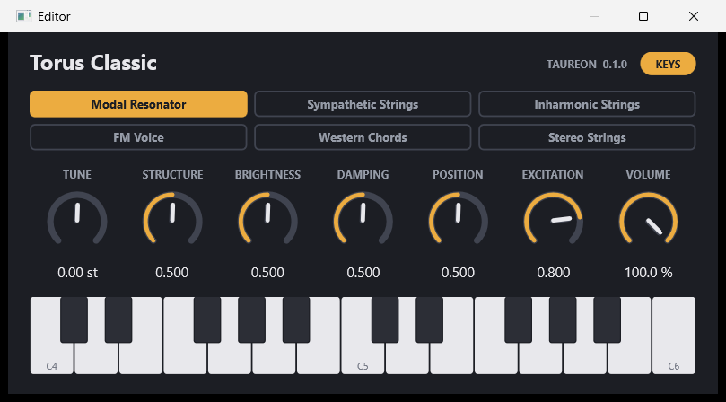

# Torus Classic

VST3 instrument, version 0.1.1, Windows x64. The Rings/Torus keyboard engine
of the Daisy Seed3 firmware *Physical Modeling*, without its reverb, inside a
native plug-in: six synthesis models, four voices, dry stereo output.



**Status:** built and tested automatically on one machine; passes Steinberg's
validator.

* First DAW result, version 0.1.0 in Studio One on 2026-11-14: it loads and
  is displayed correctly; screen keys, knobs, MIDI notes and the pitch wheel
  work; saved settings come back; the CPU load is negligible. Waveform, Live
  and the rest of the [DAW test list](docs/DAW_TEST_0.1.0.md) are open.
* Codex reviewed 0.1.0 and found four defects
  ([review](docs/CODEX_REVIEW_0.1.0.md)). They are fixed since 0.1.1
  ([what was done](docs/CODEX_REVIEW_0.1.0_UMSETZUNG.md)); the fixes have not
  been re-reviewed.
* The [build report](docs/BUILD_REPORT_0.1.0.md) describes 0.1.0: what was
  verified then and what was not.

## Sound

Six models, in the order of the firmware:

| # | Model | What it is |
| --- | --- | --- |
| 1 | Modal Resonator | Struck modal resonator |
| 2 | Sympathetic Strings | A string with sympathetic strings |
| 3 | Inharmonic Strings | A string with dispersion |
| 4 | FM Voice | Two-operator FM with an envelope |
| 5 | Western Chords | Sympathetic strings tuned to chords |
| 6 | Stereo Strings | Dispersive strings, cross-mixed to stereo, right channel inverted |

*Stereo Strings* is the firmware's "String & Reverb" without the reverb its
name referred to: the synthesis is the same. At Position 0.5 its two channels
are exact opposites, so a mono sum of that model cancels.

Four voices, always. A fifth strike takes over the voice that was struck
longest ago. There is no note-off: a struck resonator rings until it has
decayed, and Damping decides how long. At full Damping the string models and
the FM voice sustain without end.

**No reverb.** The plug-in computes none, holds no reverb memory and has no
reverb or dry/wet control. Add one in the DAW if wanted.

| Control | Range | Default | Notes |
| --- | --- | --- | --- |
| Tune | −24 to +24 semitones, continuous | 0 | Sounding notes follow |
| Structure | 0 to 1 | 0.5 | Meaning depends on the model; chord in Western Chords |
| Brightness | 0 to 1 | 0.5 | |
| Damping | 0 to 1 | 0.5 | Decay time; 1 sustains |
| Position | 0 to 1 | 0.5 | Excitation position; stereo mix in Stereo Strings |
| Excitation | 0 to 1 | 0.8 | Multiplied by the velocity at the strike |
| Model | six models | Modal Resonator | A change fades out, switches, fades in: about 8 ms |
| Volume | 0 to 100 % | 100 % | The firmware's master, in front of the limiter |

Controls take effect within about 5 ms, the firmware's smoothing. Ctrl+click
resets a knob; the mouse wheel moves it in small steps, Tune in semitones.
Typed values accept one number and optionally the unit: `-7.5`, `-7.5 st`,
`50 %`, `2,5`; the model its name or its number 1 to 6. Anything else is
refused.

### Level

Volume acts in front of the firmware's output stage: gain 0.8, linear up to
0.6 of full scale, then a soft knee that stays below 0.8 (−1.9 dBFS). 100 % is
the firmware's level; there is no gain above it. At 48 kHz no sample exceeds
0.8. At other sample rates the curve between the engine's samples can run a
little higher.

## MIDI

| MIDI | Effect |
| --- | --- |
| Note-on, any channel | Strikes a note; velocity 1 to 127 scales Excitation |
| Note-off, note-on with velocity 0 | Nothing: no new strike, the tail rings on |
| Pitch wheel | ±2 semitones, added to Tune, smoothed |
| CC 20, 21, 22, 23, 24, 25 | Tune, Structure, Brightness, Damping, Position, Excitation |
| CC 28 | Model: the value range in six equal parts |
| CC 33 | Volume |

These are the firmware's controller numbers. Its reverb controllers (26, 27,
30, 31, 32) and its polyphony controller (29) are not assigned. No MPE, no
aftertouch.

VST3 hosts do not pass MIDI controllers through. The plug-in tells the host
which controller belongs to which parameter; whether pitch wheel and CCs
arrive is up to the host and still to be tried.

### Screen keyboard

25 keys, C4 to C6, velocity 100. A click strikes a key; dragging strikes each
new key. **KEYS** shows and hides the keyboard. Screen keys do not go through
the host's MIDI and are not recorded. They sound from the next audio block
on. A key clicked while the host renders no audio is dropped after half a
second instead of sounding later, and so is a key clicked before a state is
loaded. If the host offers no messages between the
two halves of a plug-in, screen keys play nothing.

### Window

Resizable between 50 % and 200 %, aspect ratio kept, drawn as vectors; on top
of that it follows the Windows display scale. Size and keyboard are saved
with the project, apart from the sound. If a host refuses the larger window
that KEYS needs, the keyboard stays hidden; if a host forces a smaller window,
the content shrinks to fit.

## Timing: what is exact and what is not

The engine runs at 48 kHz in steps of 12 samples (0.25 ms), as in the
firmware, whatever the host does. Three things follow.

**Notes are not sample-accurate.** A note, and every parameter change, acts
on the first 12-sample step that is not before its time: up to 0.25 ms late,
never early. The steps run through from the moment the plug-in is activated;
they do not restart with each block. The same events at the same sample
positions give the same output for every block size.

**At most four strikes per step.** More notes on one step start in the
following steps, in the order they arrived: a nine-note chord is spread over
0.5 ms. Up to 256 strikes can wait in the engine and 1024 notes in front of
it; beyond that notes are dropped. Of each control 256 automation points can
wait; beyond that the newest waiting point gives way to the next, so a step
of the automation is lost while the latest value still arrives, at its own
time. Nothing acts before its time, full queues or not.

**Other sample rates add latency.** At 48 kHz the engine's samples go out
unchanged. At any other rate they are converted by a 96-tap windowed-sinc
filter, and the plug-in reports its delay to the host:

| Host rate | Reported latency | Flat within 0.01 dB up to | Images and aliases |
| --- | --- | --- | --- |
| 44.1 kHz | 49 samples (1.11 ms) | 19.1 kHz | below −100 dB |
| 48 kHz | 0 | unchanged | none |
| 88.2 kHz | 90 samples (1.02 ms) | 20.8 kHz | below −100 dB |
| 96 kHz | 97 samples (1.01 ms) | 20.8 kHz | below −100 dB |
| 192 kHz | 195 samples (1.02 ms) | 20.8 kHz | below −100 dB |

Higher host rates do not add bandwidth: the sound is the 48 kHz engine's.
Other rates from 1 kHz to 4 MHz work the same way. A host that compensates
the reported latency plays notes on time again, up to the 0.25 ms step.

The latency depends on the sample rate alone. It is fixed when the host sets
the rate, which hosts do while the plug-in is inactive, and never changes
while audio runs. After activation the filter starts from silence, so the
first samples up to the latency are silent. There is nothing to flush at the
end: resonators can ring without end, and the plug-in reports an infinite
tail.

Parameter automation is applied point by point, as steps that the engine's
5 ms smoothing rounds off; ramps between points are not interpolated.

## State

The project stores the eight controls (version 1: eight normalized values).
The pitch wheel is not stored and returns to its centre on loading. Sounding
notes are not stored either: **loading a state silences the instrument** and
restarts it with the loaded values, as does activating the plug-in. A damaged
state (wrong version, cut short, values that are not numbers from 0 to 1) is
refused whole and changes nothing.

Every instance has its own noise source, started from the same seed at every
activation and every loaded state. A project therefore renders the same way
every time; two instances given the same notes sound identical.

## Differences from the firmware

* No reverb, and so no default 25 % wet signal: the plug-in sounds drier than
  the Daisy kit at its defaults.
* With the firmware's Dry/Wet at exactly 0, the plug-in at 48 kHz delivers the
  firmware engine's output sample for sample, given events on the same
  12-sample steps. This is tested against a pinned copy of the firmware
  engine, compiled by the same compiler; it says nothing about ARM builds.
* Denormal numbers count as zero while the plug-in renders: without that a
  decayed tail costs about forty times the computing time. Tails therefore end
  in exact silence; in the test runs the difference to the firmware's float
  mode stayed near 1e-39.
* No hardware keys, pots or switches. Host parameters replace them; a model
  change needs no 20 ms debounce.
* The pitch wheel arrives as a host parameter and is mapped back to the
  firmware's 14-bit curve.
* Each instance has its own noise generator; the firmware has one.

## Install

Nothing is installed automatically. Copy the bundle `Torus Classic.vst3`
(the whole folder) from `build/windows-vs2026-x64/VST3/Release/`, or from
`out/torus-classic-<version>/` after a release build was staged there, to a
VST3 folder, then let the DAW rescan: `%LOCALAPPDATA%\Programs\Common\VST3\`
for the current user (no administrator rights; where Toy Piano Classic sits on
the development machine) or `C:\Program Files\Common Files\VST3\` for all
users. The plug-in needs no Visual C++ redistributable.

## Build and test

See the [repository README](../../README.md). The presets build Toy Piano
Classic and Torus Classic together; Steinberg's validator runs on each bundle
at the end of the build.

```bash
ctest --preset windows-vs2026-x64-release -R torus-classic
```

| Test | What it covers |
| --- | --- |
| `torus-classic.engine` | Dry engine against the pinned firmware engine; six models, notes, tails, voice stealing; instance isolation; no allocation |
| `torus-classic.adapter` | Block sizes, event timing, filter passband and rejection, latency, long-run sample counts, queue limits, reset |
| `torus-classic.plugin` | The VST3 processor against the firmware engine; block sizes in 32 and 64 bit; sample rates; several instances; life cycle; states; controller; editor in a window |
| `torus-classic.provenance` | Copied files match the recorded hashes; one version number everywhere |

`bench_torus_classic` prints the performance figures of the build report; it
is built with the tests and run by hand.

## Structure

Four layers, one CMake target each; every layer knows only the one below
through a small header.

| Layer | Directory | Interface | Contents |
| --- | --- | --- | --- |
| 1 | [`core/`](core/) | Torus headers | Vendored Torus DSP and stmlib parts, patched for the desktop |
| 2 | [`engine/`](engine/) | `dry_engine.h` | Dry instrument: notes, voices, parameters, output stage |
| 3 | [`adapter/`](adapter/) | `stream_adapter.h` | Sample rate, 12-sample steps, event time, latency |
| 4 | [`source/`](source/) | VST3 | Processor, controller, state, editor |

Versions and origins of all parts: [`components.json`](components.json).
Where the code comes from and what was changed:
[UPSTREAM.md](UPSTREAM.md). License texts: [`licenses/`](licenses/). The
engine computes in 32-bit float; 64-bit host buffers receive the same values
converted.

The window, the state handling and the tests follow Toy Piano Classic 0.3.2,
including the fixes from its code reviews. Nothing was moved to `common/`:
Toy Piano Classic was being changed while this was written, and its files
were left alone.
