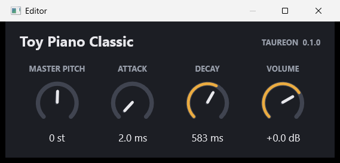

# Toy Piano Classic

VST3 instrument, version 0.1.0. First test object of this repository: the
sound engine of the Daisy Seed3 firmware *Toy Piano*, running unchanged inside
a native Windows plug-in.



**Status:** builds, passes Steinberg's validator and its own tests. It loads in
Studio One and its knobs respond there. Nobody has listened to it in a DAW yet,
see [Still to be checked](#still-to-be-checked).

## Sound and controls

A sine with a quiet second harmonic (12 %), struck with a one-shot
attack/decay envelope. 16 voices. Releasing a key does not stop a note.

| Control | Range | Default | Notes |
| --- | --- | --- | --- |
| Master Pitch | −24 to +24 semitones, whole steps | 0 | Sounding notes follow within a few milliseconds |
| Attack | 2 to 300 ms, logarithmic | 2 ms | Applies from the next strike |
| Decay | 50 to 3000 ms, logarithmic | 583 ms | Applies from the next strike |
| Volume | silence, then −60 to +24 dB | 0 dB | 0 dB is the firmware's level |

Ctrl+click resets a knob to its default; the mouse wheel moves it in small
steps. The window has a fixed layout and follows the Windows display scale.

Volume acts in front of the engine's soft limiter. Raising it makes notes
louder and dense chords more compressed, but the output never exceeds 0.8 of
full scale (−1.9 dBFS). At 0 dB a single note at full velocity peaks near
−27 dBFS, because the firmware sizes its gain for 16 keys at once.

## MIDI

| MIDI | Effect |
| --- | --- |
| Note-on, any channel | Strikes a note; velocity sets its level linearly |
| Note-off | Ignored |
| Pitch wheel | ±2 semitones, added to Master Pitch |
| CC 16 | Master Pitch (value 64 is 0) |
| CC 73 | Attack |
| CC 75 | Decay |

The numbers are constants in [source/parameters.h](source/parameters.h).

VST3 does not hand controllers to a plug-in directly. The plug-in tells the
host which controller belongs to which parameter, and the host translates.
Whether the pitch wheel and the three CCs arrive therefore depends on the host.

## Build

From the repository root, after fetching the SDK as described in the
[main README](../../README.md):

```bash
cmake --preset windows-vs2026-x64
```

```bash
cmake --build --preset windows-vs2026-x64-release
```

```bash
ctest --preset windows-vs2026-x64-release
```

The build ends with Steinberg's validator run on the plug-in. Result:
`build/windows-vs2026-x64/VST3/Release/Toy Piano Classic.vst3` (a folder).

## Install

Copy the folder `Toy Piano Classic.vst3` into a VST3 folder and rescan in the
DAW. Without administrator rights, in PowerShell:

```powershell
Copy-Item "build\windows-vs2026-x64\VST3\Release\Toy Piano Classic.vst3" "$env:LOCALAPPDATA\Programs\Common\VST3\" -Recurse -Force
```

`%LOCALAPPDATA%\Programs\Common\VST3` is the per-user VST3 folder. If a DAW
does not scan it, add it to the DAW's plug-in locations, or copy the folder to
`C:\Program Files\Common Files\VST3` as administrator.

## What the study showed

**The firmware engine runs unchanged.** `core/toy_piano.h`, `core/toy_piano.cpp`
and `core/config.h` are byte-identical to the firmware sources;
[core/README.md](core/README.md) lists their Git blobs. The only stand-in is a
short header for the one DaisySP function the engine calls.

**The plug-in's output equals the engine's, bit for bit.** With Master Pitch 0,
Volume 0 dB and the pitch wheel centred, a performance of 90 notes rendered
through the plug-in matches the bare engine sample for sample, at host block
sizes of 1, 16, 48, 64, 333, 1024 and 2048 samples and with 32- and 64-bit
processing.

**What had to be added lives in one small class**, [source/engine.cpp](source/engine.cpp):

* *Pitch offset.* The engine has no master pitch. Its per-voice modulation
  interface (`Modulate`, built for the firmware's modulation matrix) carries it.
* *Volume.* The engine exposes its raw sum and its limiter separately, so a
  gain fits between them without touching the engine.
* *A guard above Nyquist.* The firmware never plays higher than note 127 at
  48 kHz. A plug-in can be asked for two octaves more, or be run at a low
  sample rate. From a phase increment of 1 on, the engine's phase wrap would
  read past its sine table. Such voices are held below Nyquist and muted. This
  is the one real hazard the port uncovered.

**What the plug-in shell replaces:** the firmware's `main.cpp` (hardware, USB
MIDI, LEDs, pots). The firmware's fixed 48-sample block and its 1 kHz control
rate have no counterpart: notes start on their exact sample at any block size.

**Not transferable:** the firmware's bit-exact reference hash (`test_golden.cpp`).
It covers the whole firmware callback including keys and pots, and it was
recorded with GCC and glibc.

## Verified

| Check | Result |
| --- | --- |
| Steinberg validator (SDK 3.8.0), Release and Debug | 47 tests passed, 0 failed |
| Build, validator and tests with Visual Studio 2022 as well | passed |
| Firmware engine test compiled with MSVC ([tests/test_toy_piano_core.cpp](tests/test_toy_piano_core.cpp)) | passed |
| Bit-exact against the engine, 7 block sizes, 32/64 bit | passed |
| A4 = 440 Hz at 44.1, 88.2, 96 and 192 kHz | within 0.05 Hz |
| Master Pitch −24 to +24, pitch wheel ±2 | frequencies within 0.01 % |
| Pitch and volume changes while a note sounds | no jump in the waveform |
| Notes above Nyquist at 8, 22.05, 44.1, 48 kHz | muted, bounded, no table overrun |
| State save and load; damaged state | identical round trip; rejected |
| Parameter texts, MIDI controller map | as in the tables above |
| Window in the SDK's `editorhost` at 120 % display scale | drawn as in the picture |
| Studio One: plug-in loads, knobs respond | reported by the operator |

Everything but the last row is automated or was captured by script. All of it
ran on one machine: Windows 11 x64, MSVC 19.51 (Visual Studio
Build Tools 2026) and MSVC 19.44 (Build Tools 2022).

## Still to be checked

* Listening test in Studio One: notes, velocity, level, and Master Pitch moved
  while a note sounds.
* Loads and plays in Tracktion Waveform 14 and Ableton Live 12 Lite.
* Mouse wheel and Ctrl+click on the knobs.
* Knobs, host automation and the host's own parameter view stay in step.
* Pitch wheel and CC 16/73/75 reach the plug-in in each DAW.
* Project save and reload restores the four values.
* Window size on displays with other scale factors, and when moved between
  displays.
* CPU load. It has not been measured.

## Limits of this version

* Parameter changes take effect at block boundaries. For Attack, Decay and
  Volume that is inaudible; a pitch wheel move is quantised to the host's block
  size and then smoothed over about 5 ms.
* Attack and decay are read at the strike. Automating them does not bend notes
  that already sound, as in the firmware.
* No presets, no on-screen keyboard, no resizable window.

## Sources

| Path | Contents |
| --- | --- |
| `core/` | The firmware engine, unchanged |
| `source/engine.*` | Pitch offset, volume, Nyquist guard |
| `source/parameters.h` | Parameters, ranges, MIDI controller numbers |
| `source/processor.*` | Audio side: MIDI notes in, stereo out, state |
| `source/controller.*` | Parameters as the host sees them, MIDI controller map |
| `source/editor.*` | The window |
| `source/factory.cpp`, `plugin_ids.h`, `version.h` | Registration, IDs, version |
| `tests/` | Engine test from the firmware, plug-in test |
